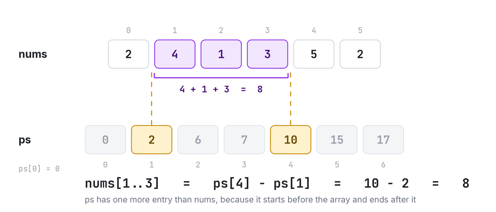
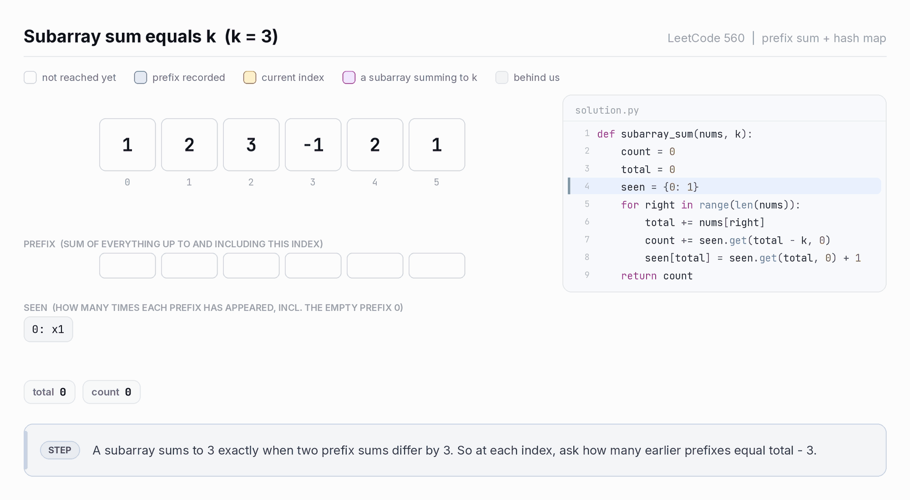
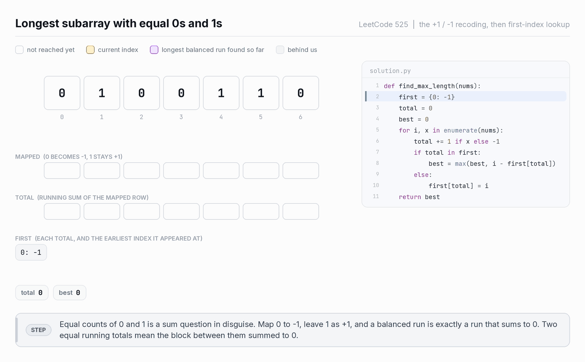
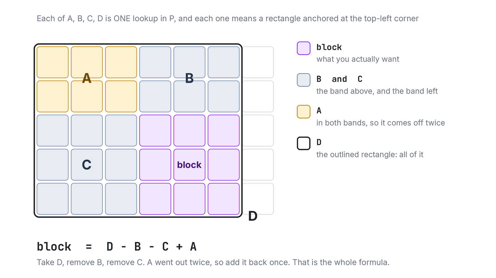
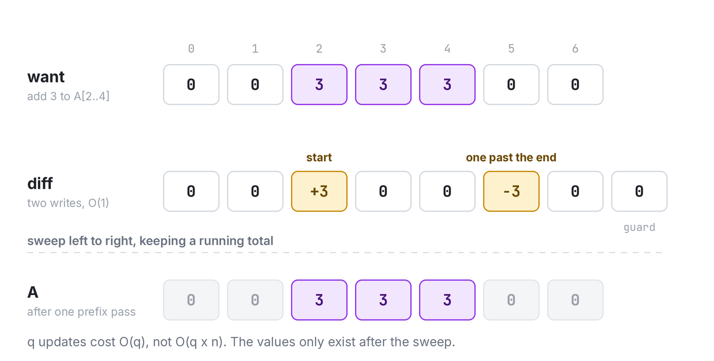
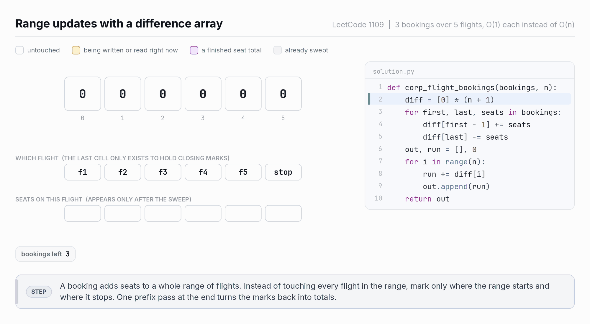
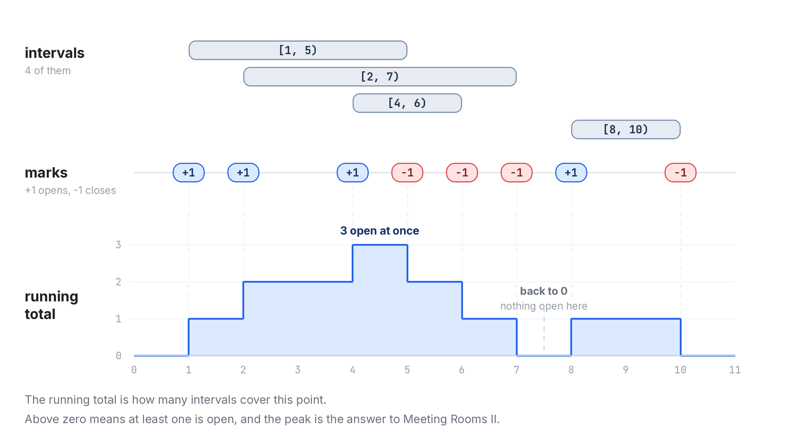
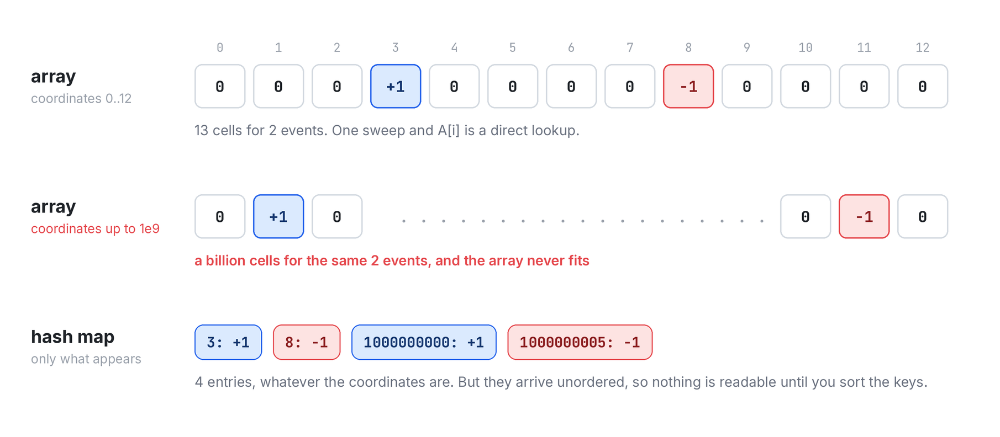

# Prefix Sum

`ps[i]` is the sum of everything before index `i`. Subtract two of them and you get the
block in between.

```
ps[j + 1] - ps[i]  =  sum of nums[i..j]
```



Three things follow from that one line, and they are the three sections of this document.

| You know | You want | Tool |
|---|---|---|
| both ends | the sum | a prefix array, 1D or 2D |
| one end and the sum | the other end | a hash map |
| the sums | the array | a difference array |

---

## Contents

- [The core](#the-core)
- [Range query](#range-query)
- [Hash map search](#hash-map-search)
  - [The four knobs](#the-four-knobs)
  - [Read before you write](#read-before-you-write)
  - [Recoding the key](#recoding-the-key)
- [Two dimensions](#two-dimensions)
- [Difference array](#difference-array)
  - [Reading the running total](#reading-the-running-total)
  - [Array or hash map](#array-or-hash-map)
- [When it breaks](#when-it-breaks)
- [Pitfalls](#pitfalls)
- [Drills](#drills)
- [Reference card](#reference-card)

---

## The core

Build it in one line. `initial=0` is what gives you the leading zero.

```python
from itertools import accumulate

ps = list(accumulate(nums, initial=0))     # len(ps) == len(nums) + 1, ps[0] == 0
ps[r + 1] - ps[l]                          # sum of nums[l..r], both ends included
```

`ps[0] = 0` is the sum before the array starts. Without it, a subarray beginning at index
`0` has no left cut to subtract, and you end up writing a special case in every problem.
It reappears later as `{0: 1}`, `{0: -1}` and `min_prefix = 0`, always meaning the same
thing.

The pattern works because addition has an inverse. That is the whole precondition, and it
is the test to run before writing anything:

| Operation | Prefix works? | If not |
|---|---|---|
| sum, XOR | yes, both have an inverse | |
| product | only with no zeros | prefix pass + suffix pass (LC 238) |
| min, max | no inverse at all | sparse table, or a segment tree |
| sum, but the array changes | the inverse is fine, the array is not | Fenwick tree (LC 307) |

---

## Range query

Both ends given. Build once, subtract per query.

```python
class NumArray:
    def __init__(self, nums: list[int]):
        self.ps = list(accumulate(nums, initial=0))

    def sumRange(self, left: int, right: int) -> int:
        return self.ps[right + 1] - self.ps[left]
```

O(n) to build, O(1) per query. The related move is that a **suffix is the total minus a
prefix**, so a "split the array in two" question needs one running number and one grand
total, never two arrays:

```python
def pivot_index(nums: list[int]) -> int:
    total = sum(nums)
    left = 0
    for i, x in enumerate(nums):
        if left == total - left - x:       # right side, without building it
            return i
        left += x
    return -1
```

| LC | Title | Diff | Freq | Note |
|---|---|---|---|---|
| 303 | Range Sum Query, Immutable | Easy | 🔥🔥 | the bare identity |
| 724 | Find Pivot Index | Easy | 🔥🔥🔥 | total minus running |
| 1480 | Running Sum of 1d Array | Easy | 🔥 | `accumulate` and nothing else |
| 1732 | Find the Highest Altitude | Easy | 🔥 | running max over a prefix |
| 1310 | XOR Queries of a Subarray | Med | 🔥 | swap `+` for `^` |
| 307 | Range Sum Query, Mutable | Med | 🔥🔥 | writes break `ps`, use a Fenwick tree |
| 238 | Product of Array Except Self | Med | 🔥🔥🔥 | no inverse, so two passes |

---

## Hash map search

Now only the right end is known. Standing at `j` with a running total, you need a left cut
that makes the block satisfy some constraint.

> You are never searching for a subarray. You are searching for an **earlier prefix**.

Scanning back for it is O(n²). A map of every prefix already passed answers it in O(1).

### The four knobs

Every problem in this section is the same loop. Four things vary, and nothing else does.

```python
seen = INIT                          # 1
total = 0
for j, x in enumerate(nums):
    total += x
    key = KEY(total)                 # 2
    ...  seen.get(LOOKUP)  ...       # 3
    INSERT(seen, key, j)             # 4
```

| What you want | key you store | what you look up | insert rule | init | LC |
|---|---|---|---|---|---|
| count of subarrays summing to `k` | `total` | `seen[total - k]` | always `+= 1` | `{0: 1}` | 560 |
| count of subarrays divisible by `k` | `total % k` | `seen[key]` | always `+= 1` | `{0: 1}` | 974 |
| longest summing to `k` | `total` | `first[total - k]` | **only if new** | `{0: -1}` | 325 |
| longest with equal 0s and 1s | `total`, after `0 -> -1` | `first[key]` | **only if new** | `{0: -1}` | 525 |
| shortest hitting a remainder | `total % p` | `last[(total - t) % p]` | **overwrite always** | `{0: -1}` | 1590 |
| exists, length ≥ 2, divisible by `k` | `total % k` | `first[key]`, then check the gap | **only if new** | `{0: -1}` | 523 |
| best subarray sum | `total` | `min_prefix`, one number | `min_prefix = min(...)` | `0` | 53 |

The insert column is the one that matters. Longest and shortest are the same three lines
with one `if` deleted:

```
COUNT      always increment      every earlier match is a separate subarray
LONGEST    never overwrite       the earliest left cut gives the widest block
SHORTEST   always overwrite      the nearest left cut gives the tightest block
```

Get that backwards and you return a real number that is not the answer, which is why it
survives the sample tests. Say which of the three you are writing before you type the
dictionary.

Here is the one worth writing out in full, because everything else is a substitution into
it.



```python
def subarray_sum(nums: list[int], k: int) -> int:
    seen = {0: 1}
    total = 0
    count = 0

    for x in nums:
        total += x
        count += seen.get(total - k, 0)          # read
        seen[total] = seen.get(total, 0) + 1     # then write

    return count
```

`total - earlier == k` is the same statement as `earlier == total - k`. That rearrangement
is the entire algorithm.

### Read before you write

Query the map for the current prefix, then insert it. Insert first and a prefix matches
itself, reporting a subarray of length zero. On `nums = [1]`, `k = 0` the correct answer
is `0` and the wrong order returns `1`.

The same ordering shows up without a map at all:

```
560   count += seen[total - k]      before   seen[total] += 1
525   read first[total]             before   writing first[total]
53    best = total - min_prefix     before   min_prefix = min(min_prefix, total)
724   compare left to the rest      before   left += nums[i]
```

The init value is what stands in for the one prefix that legitimately exists before the
loop starts.

### Recoding the key

The key column is where a problem that mentions no sum gets turned into one. This is the
part worth practising, because the loop underneath never changes.

| Recoding | Turns | Into |
|---|---|---|
| `0 -> -1`, `1 -> +1` | equal counts | a total of `0` |
| `x -> +1 if p(x) else -1` | "more true than false" | a total `> 0` |
| `x -> x % k` | divisible by `k` | two equal keys |
| `+ -> ^` | XOR of a range | `ps[r+1] ^ ps[l]` |
| one prefix array per category | "how many X in this range" | one subtraction per category |

Contiguous Array (LC 525) is the clearest instance. Equal counts of `0` and `1` is not a
sum question until you map `0` to `-1`, and then it is.



```python
def find_max_length(nums: list[int]) -> int:
    first = {0: -1}
    total = 0
    best = 0

    for i, x in enumerate(nums):
        total += 1 if x else -1
        if total in first:
            best = max(best, i - first[total])
        else:
            first[total] = i              # write once, never again
    return best
```

Two notes that cost people this problem:

- The `else` is the whole difference between longest and shortest. Delete it and you
  measure the nearest match instead of the earliest one.
- `i - first[total]` needs no `+1`. `first` stores the cut *before* the block, so the
  difference is already a length.

Outside Python, `%` follows the sign of the dividend, so `-3 % 5` is `-2` and equal
remainders land in different buckets. Normalize with `((x % k) + k) % k`. This is the most
common wrong answer on LC 974 and it never appears in Python.

### Search problems

| LC | Title | Diff | Knob that changes | Freq |
|---|---|---|---|---|
| 560 | Subarray Sum Equals K | Med | the reference implementation | 🔥🔥🔥 |
| 974 | Subarray Sums Divisible by K | Med | key becomes `% k` | 🔥🔥🔥 |
| 930 | Binary Subarrays With Sum | Med | nothing, it is 560 | 🔥🔥 |
| 325 | Maximum Size Subarray Sum Equals k | Med | count becomes length | 🔥🔥 |
| 525 | Contiguous Array | Med | key gets a `±1` recoding | 🔥🔥🔥 |
| 1124 | Longest Well-Performing Interval | Med | `±1` on a different predicate | 🔥 |
| 523 | Continuous Subarray Sum | Med | a length check after the lookup | 🔥🔥 |
| 1590 | Make Sum Divisible by P | Med | insert overwrites | 🔥🔥 |
| 53 | Maximum Subarray | Med | the map collapses to one number | 🔥🔥🔥 |
| 1442 | Count Triplets With Equal XOR | Med | `+` becomes `^` | 🔥 |
| 1177 | Can Make Palindrome from Substring | Med | one prefix count per letter | 🔥 |
| 862 | Shortest Subarray with Sum at Least K | Hard | a deque replaces the map | 🔥🔥 |
| 437 | Path Sum III | Med | the array is a root-to-node path | 🔥🔥 |

Two of those leave the template, and both are worth knowing about.

**LC 862.** A running minimum is not enough, because you need the *nearest* left cut that
is low enough, not the lowest one. Keep a deque of prefix indices with increasing values.
Pop the front while `ps[j] - ps[dq[0]] >= k`, recording the length, because that cut
already works and no further one is shorter. Pop the back while `ps[dq[-1]] >= ps[j]`,
because an older prefix that is not smaller can never be a better left cut.

**LC 437.** A root-to-node path is a prefix. Carry the same hash map down the recursion,
increment on the way in, decrement on the way out, and LC 560 solves a tree problem
unchanged.

---

## Two dimensions

Same idea, cuts in both directions. `P` is `(m+1) x (n+1)` so the padding row and column
are the empty prefix. Reading a rectangle takes four terms instead of two.



```python
class NumMatrix:
    def __init__(self, matrix: list[list[int]]):
        m, n = len(matrix), len(matrix[0])
        self.p = [[0] * (n + 1) for _ in range(m + 1)]
        for i in range(m):
            for j in range(n):
                self.p[i + 1][j + 1] = (matrix[i][j]
                                        + self.p[i][j + 1]     # above
                                        + self.p[i + 1][j]     # left
                                        - self.p[i][j])        # counted twice

    def sumRegion(self, r1: int, c1: int, r2: int, c2: int) -> int:
        p = self.p
        return (p[r2 + 1][c2 + 1] - p[r1][c2 + 1] - p[r2 + 1][c1] + p[r1][c1])
```

Build and read use the same four terms for the same reason. The padding is not a style
choice: without it every `i - 1` needs a bounds check and the formula becomes eight
branches.

| LC | Title | Diff | Freq | Note |
|---|---|---|---|---|
| 304 | Range Sum Query 2D, Immutable | Med | 🔥🔥🔥 | the four-corner formula |
| 1314 | Matrix Block Sum | Med | 🔥🔥 | clamp the corners, leave the formula alone |
| 1074 | Number of Submatrices That Sum to Target | Hard | 🔥🔥 | see below |
| 363 | Max Sum of Rectangle No Larger Than K | Hard | 🔥 | same collapse, then a sorted list |
| 221 | Maximal Square | Med | 🔥🔥 | looks 2D-prefix, is DP |

LC 1074 is the payoff. Fix a top row and a bottom row, collapse every column between them
into one number with the 2D prefix, and what remains is a 1D array on which LC 560 runs
unchanged. Two sections of this document stacked, and an O(m²n) answer to something that
looks O(m²n²).

---

## Difference array

Run the arrow the other way. `D[i] = A[i] - A[i-1]`, and prefix-summing `D` gives back
`A`. They are inverses, which is what makes range *writes* cheap.

To add `v` to `A[l..r]` you touch two cells, not `r - l + 1`.



The two rules that cause every bug here:

- **The `-v` goes one past the end.** For an inclusive `[l, r]`, write `D[l] += v` and
  `D[r + 1] -= v`. Putting it at `r` shortens every range by one element.
- **Size the array `n + 1`,** so `D[r + 1]` is legal when `r` is the last index.

Then read the endpoint convention off the problem, every time. Corporate Flight Bookings
(LC 1109) is inclusive with 1-indexed labels; Car Pooling (LC 1094) is half-open because a
passenger dropped at `end` is not aboard at `end`. Same pattern, and the code differs by
one character.



```python
def corp_flight_bookings(bookings: list[list[int]], n: int) -> list[int]:
    diff = [0] * (n + 1)

    for first, last, seats in bookings:
        diff[first - 1] += seats       # label -> index
        diff[last] -= seats            # last-1 is the final flight, so stop at last

    out, run = [], 0
    for i in range(n):
        run += diff[i]
        out.append(run)
    return out
```

The trade is exact, and stating it out loud is most of the pattern:

| | Per range | To rebuild | Good for |
|---|---|---|---|
| prefix sum | O(1) to **read** | O(n) after any write | many reads, no writes |
| difference array | O(1) to **write** | O(n) to read anything | many writes, then one read |

Both interleaved and neither works. That is a segment tree with lazy propagation.

In 2D, one update is four marks, and they are the same four cells and the same four signs
as the 2D read, travelling the other way:

```
read     + p[r2+1][c2+1]   - p[r1][c2+1]   - p[r2+1][c1]   + p[r1][c1]
write    + d[r1][c1]       - d[r1][c2+1]   - d[r2+1][c1]   + d[r2+1][c2+1]
```

### Reading the running total

Range updates are one use. Intervals are the other, and there the running total *is* the
answer rather than a step toward it. Mark `+1` where an interval opens and `-1` where it
closes, and the total at any point is how many intervals cover that point.



Read the shape, not the numbers. Almost every interval problem is one of three questions
about it:

| The shape | The question it answers | Problems |
|---|---|---|
| above zero | is anything open here? | 1893 coverage, free-slot searches |
| the highest point | how many overlap at worst? | 253 Meeting Rooms II, 1094 Car Pooling |
| back down to zero | where does a merged block end? | gap finding, interval merging |

The total can never go below zero if every close is matched to an open. If yours does,
the `-1` is at the wrong endpoint.

### Array or hash map

Same two marks either way. The only question is where you put them.

An **array** indexes the coordinate directly, which is why the sweep is trivial:

```python
diff = [0] * (n + 1)
diff[l] += v
diff[r + 1] -= v                        # inclusive [l, r]
```

A **hash map** stores only the coordinates that actually appear, which is what you need
when they are timestamps, or up to `1e9`, or not integers at all:

```python
from collections import defaultdict

def min_meeting_rooms(intervals: list[list[int]]) -> int:
    delta = defaultdict(int)
    for start, end in intervals:
        delta[start] += 1
        delta[end] -= 1                 # half-open, the room frees at end

    best = run = 0
    for t in sorted(delta):             # the sort is the price of the hash map
        run += delta[t]
        best = max(best, run)
    return best
```



| | array | hash map of events |
|---|---|---|
| memory | O(n), the whole coordinate range | O(k), one entry per endpoint |
| per update | O(1) | O(1) |
| to read anything | O(n) sweep | O(k log k), the sort comes first |
| after that | a value at every index | values only at the cut points |
| "what is the value at x" | `A[x]`, O(1) | no cell exists, see below |
| reach for it when | coordinates are small and dense | coordinates are huge, sparse, or not integers |

That fifth row is the real cost, and it is easy to forget:

> The hash map has no entry for a coordinate that is not an endpoint. There is nothing to
> index, so answering "what is the value at `x`" means sorting the keys, prefix-summing
> them into segment values, then binary searching for the segment that contains `x`.
> Sweep with the hash map; look things up with the array.

The function is piecewise constant between events, so even after that work you learn the
value of a *segment*, never of a single position that the array would have handed you.

| LC | Title | Diff | Freq | Note |
|---|---|---|---|---|
| 370 | Range Addition | Med | 🔥🔥 | the pattern with nothing attached |
| 1109 | Corporate Flight Bookings | Med | 🔥🔥🔥 | inclusive, 1-indexed |
| 1094 | Car Pooling | Med | 🔥🔥🔥 | half-open, read it off the statement |
| 1893 | Check if All Integers in a Range Are Covered | Easy | 🔥 | mark, sweep, look for a zero |
| 2848 | Points That Intersect With Cars | Easy | 🔥 | the smallest instance |
| 2536 | Increment Submatrices by One | Med | 🔥 | four marks |
| 253 | Meeting Rooms II | Med | 🔥🔥🔥 | the sparse version |

---

## When it breaks

| Situation | Why | Go to |
|---|---|---|
| range min or max | no inverse, minima do not subtract | sparse table, segment tree |
| the array changes between queries | one write invalidates the tail of `ps` | Fenwick tree (LC 307) |
| range product with zeros | division undefined at zero | prefix pass + suffix pass (LC 238) |
| reads and writes interleaved | prefix is read-fast, diff is write-fast, neither is both | segment tree, lazy propagation |
| `sum >= target`, all positive | works, but a window is O(1) space | sliding window (LC 209) |
| the answer is a subsequence | not contiguous, so no pair of cuts describes it | DP |

One test catches most of these: **can I subtract two prefixes and get something
meaningful?**

---

## Pitfalls

**Forgetting the init.** `seen = {}` instead of `{0: 1}`. The answer comes out short by
exactly the cases anchored at index 0.

**Inserting before reading.** Creates a zero-length subarray. Only changes the answer when
`k == 0`, so it survives every sample.

**Overwriting the first index in a longest problem.** You then measure the shortest match.
LC 1590 is the one place you *should* overwrite, and it asks for the shortest.

**Mixing the two seeds.** `{0: 1}` counts. `{0: -1}` is an index. Swapping them gives a
`TypeError` if you are lucky.

**`D[r]` instead of `D[r + 1]`.** Drops the last element of every inclusive range, and
needs the array sized `n + 1` to have somewhere to live.

**Negative remainders outside Python.** `((x % k) + k) % k` before it becomes a key.

**Overflow.** Prefix sums grow to the sum of the whole array. Python does not care, a
32-bit `int` does.

---

## Drills

Answer without running code.

1. `ps` has `n + 1` entries and `nums` has `n`. Explain the extra entry in one sentence.
2. `nums = [2, -2, 2, -2]`, `k = 0`. Work out LC 560 by hand, then work out what the
   insert-before-read version returns. Explain the size of the gap.
3. LC 974's map holds at most `k` keys and LC 560's can hold `n`. Both look up in O(1), so
   say precisely what the bound buys you.
4. In LC 525, delete the `else` so the write runs every iteration. Give an input where the
   answer becomes too small.
5. LC 523 keeps the earliest index, LC 1590 keeps the most recent. Both are remainder
   problems on a hash map. Name the property of each question that forces its choice.
6. Someone says the 2D write marks are the 2D read formula with the signs flipped. Write
   both out and say whether that is true.
7. LC 1109 writes `diff[first - 1] += seats` and `diff[last] -= seats`. Only one line has a
   `-1`. Explain both, then say what changes if the range were half-open.
8. A problem needs range sums *and* range updates, interleaved, a million of each. Say what
   each of the two tools gets wrong.
9. Prefix minimum, `M[i] = min(nums[0..i-1])`. Give a three-element counterexample showing
   it cannot answer "the minimum of `nums[l..r]`".

---

## Reference card

```
IDENTITY       ps[r+1] - ps[l] = sum of nums[l..r]     ps = accumulate(nums, initial=0)
               needs an invertible op: sum and XOR yes, min and max no,
               product only without zeros

YOU ARE NEVER SEARCHING FOR A SUBARRAY.
YOU ARE SEARCHING FOR AN EARLIER PREFIX.

READ BEFORE YOU WRITE.
               560 read seen[total-k] before seen[total]++
               525 read first[total]   before first[total]=i
               53  best = total-min    before min_prefix = min(...)

THE FOUR KNOBS, and the insert rule is the one that decides everything
               key      total  |  total % k  |  total after a +-1 recoding
               lookup   seen[key - k]  |  seen[key]  |  min_prefix
               insert   always  ->  count           560 974 930
                        only if new  ->  longest    525 325 1124 523
                        overwrite  ->  shortest     1590
               init     {0: 1} counts | {0: -1} index | 0 running min

RANGE QUERY    303 Range Sum Query   724 Pivot Index   238 Except Self
2D             304 four corners, D - B - C + A        1314 clamp   1074 fix two rows

DIFFERENCE     D[l] += v, D[r+1] -= v, size n+1, prefix once at the end
               370 Range Addition   1109 inclusive   1094 half-open
               2536 four marks      253 sweep line when coords are sparse

READ vs WRITE  prefix   O(1) read, O(n) rebuild after a write
               diff     O(1) write, O(n) to read anything
               both interleaved -> segment tree with lazy propagation

WATCH OUT      seed the empty prefix, or index 0 is invisible
               D[r+1], not D[r], and check the endpoint convention
               ((x % k) + k) % k outside Python
               positives + sum >= target -> a sliding window is simpler
```
