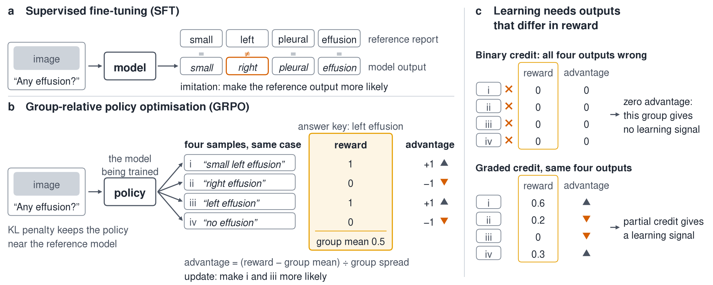
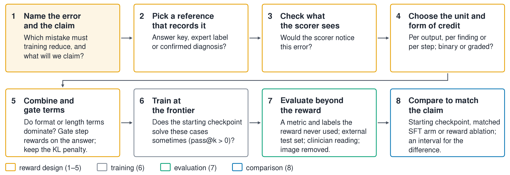

## TL;DR

- **Start from the error:** name the clinical mistake to reduce, then pick a reward whose scorer can see it.
- **Stress-test the scorer first:** score outputs broken on purpose (sides swapped, a finding deleted, a lone dash); if the score holds, training will not fix that error.
- **Gate the extras:** pay format, length and reasoning bonuses only on correct answers; report every weight and the KL coefficient, even if zero.
- **Evaluate with what the reward never saw:** another metric, labels from another source, an external test set, the image removed.
- **Match the comparison to the claim:** to say RL beat SFT, train an equally resourced SFT arm and give an interval for the difference.
- **Keep score gains and clinical benefit apart:** benefit to clinicians or patients needs its own study.

## Why rewards

The standard way to adapt a general vision-language model to radiology is supervised fine-tuning (SFT): show the model an image with a reference output, such as a radiologist's report, and make that reference more likely, token by token. SFT is efficient and stable, and it teaches the language of radiology. But every token counts the same, so "left" carries no more weight than "the", and the model never sees its own mistakes.

Reinforcement-learning (RL) post-training changes where the lesson comes from. The policy (the model being trained) samples its own outputs, a reward scores them, and an update makes the higher-scoring outputs more likely. The usual objective is

$$J(\theta)=\mathbb{E}_{x,\;y\sim\pi_\theta(\cdot\mid x)}\big[r(x,y)\big]-\beta\,\mathrm{KL}\big(\pi_\theta(\cdot\mid x)\,\big\|\,\pi_{\mathrm{ref}}(\cdot\mid x)\big).$$

In words: raise the average reward of outputs the policy itself produces, while a KL penalty of weight $\beta$ keeps it close to the reference model, a frozen copy of the model training started from.

Group-relative policy optimisation (GRPO) samples a group of $G$ outputs for each case and gives each one an advantage, its reward relative to the rest of the group:

$$A_i=\frac{r_i-\operatorname{mean}(r_1,\dots,r_G)}{\operatorname{std}(r_1,\dots,r_G)+\epsilon}.$$

An output that beat its group is pushed up and one that fell short is pushed down. A group in which every output earns the same reward gives no learning signal (Figure 1).


*Figure 1. SFT and GRPO. (a) SFT makes the reference output more likely. (b) GRPO scores four sampled answers against a key and pushes up those above the group mean; a KL penalty keeps the policy near the reference. (c) Four equally wrong answers give zero advantage: this group gives no learning signal. Graded credit separates them. Values are illustrative.*

GRPO was introduced in [DeepSeekMath](https://arxiv.org/abs/2402.03300), which dropped the critic network of PPO but still trained against a reward model (a network trained to score outputs). [DeepSeek-R1](https://doi.org/10.1038/s41586-025-09422-z) then showed that rule-checked rewards could train reasoning at scale, and medical models such as [MedVLM-R1](https://arxiv.org/abs/2502.19634) and [Med-R1](https://doi.org/10.1109/tmi.2026.3661001) adopted the recipe in early 2025. Related methods: [SCST](https://arxiv.org/abs/1612.00563) scores a sampled output against the reward of the greedy-decoded output; [PPO](https://arxiv.org/abs/1707.06347) trains a critic to estimate expected return and clips the policy ratio to discourage large updates; [DPO](https://arxiv.org/abs/2305.18290) learns from pairs of preferred and rejected outputs, with the KL constraint built into its loss.

**What to do:** decide what the reward should teach before you choose the algorithm; training will optimise whatever the reward scores.

## The reward cookbook

Each design below has a sketch (pseudocode; helper functions such as `tags_ok` stand for your own code), a medical example, what it misses and the fix.

### 1. Answer key plus format (the R1 recipe)

A verifier (a rule that checks the output against an answer key) credits the correct option, and a format term credits the required tags. MedVLM-R1 adds the two for a total between 0 and 2, with half credit when the right letter comes wrapped in extra text; Med-R1 uses the same pair of terms.

```python
fmt = 1.0 if tags_ok(out, ["think", "answer"]) else 0.0
acc = 1.0 if extract_choice(out) == key else 0.0
r = fmt + acc
```

*Misses:* whether the reasoning is sound and whether the answer came from the image; on yes/no or four-option questions, guesses often earn full credit. *Fix:* keep the format term small next to the answer term, and test the trained model with the image removed.

### 2. Graded credit for ordinal and hierarchical labels

Binary credit treats a near miss like a gross error. [A retinal-grading study](https://arxiv.org/abs/2602.10619) paid 1, 1/4 and 1/16 for a grade distance of 0, 1 and 2, nothing beyond; exact-grade accuracy on RetinaMNIST rose from 43.50 to 60.25 over an exact-match reward. [Skin-R1](https://doi.org/10.1007/978-3-032-37314-4_1) credits a diagnosis by how deep along the correct taxonomy path it lands, which raised out-of-distribution accuracy over a standard reward.

```python
credit = {0: 1.0, 1: 0.25, 2: 1 / 16}          # by grade distance
r = 0.9 * credit.get(abs(pred - true), 0.0) + 0.1 * fmt
```

*Misses:* direction, since overcalling and undercalling cost the same. *Fix:* make credit asymmetric when one direction is clinically worse, and report error size beside accuracy.

### 3. Report rewards from labellers and learned metrics

A labeller (rule-based or learned software that pulls findings out of report text) reads the generated and the reference report, and the reward is their agreement: CheXbert F1 over 14 finding labels, RadGraph F1 over entities and relations, or RadCliQ, a composite fitted to radiologists' error counts.

```python
r = f1(chexbert(gen), chexbert(ref))     # 14 labels: present, absent, uncertain
```

*Misses:* findings outside the label set, and laterality: CheXbert records that an effusion is present, not on which side, so "right effusion" earns full credit when the effusion is on the left. One metric alone can also be gamed. In [RadVLM-GRPO](https://arxiv.org/abs/2512.10691), RadGraph F1 as the only reward barely raised RadGraph F1, every other reported metric got worse, and average report length fell by more than half (207 to 93); with RadCliQ as the reward, all of these metrics improved.

*Fix:* per-finding credit that checks side and weights findings by severity, agreed with radiologists, so a missed nodule costs more than a minor omission. [Su and Wang](https://doi.org/10.1109/access.2026.3716267) scaled their report reward by case severity, and dropping that scaling hurt more than dropping any other single term.

```python
w = {f: severity[f] for f in union(findings(ref), findings(gen))}
r = sum(w[f] * agrees(f, gen, ref, check_side=True) for f in w) / sum(w.values())
```

### 4. Text overlap and embedding similarity

BLEU, ROUGE, CIDEr, BERTScore and embedding cosine compare wording with the reference. Swapping "left" for "right" changes one token among many, and they can credit nonsense. [MediX-R1](https://arxiv.org/abs/2602.23363) turned embedding similarity into a binary reward at a cosine of 0.8, and the answer "-" earned full credit against the reference "Renal artery".

```python
r_emb = 1.0 if cosine(embed(answer), embed(key)) >= 0.8 else 0.0
if too_short(answer) or mostly_punctuation(answer):   # the authors' later fix
    r_emb = 0.0
```

*Misses:* facts and laterality. *Fix:* pair it with a term that checks findings, and stress-test it on degenerate answers.

### 5. Box and mask overlap

For grounding and segmentation, intersection over union (IoU) or Dice against an annotation is the natural reward. [MedGround-R1](https://arxiv.org/abs/2507.02994) sums a format term, a binary IoU term (1 when IoU exceeds 0.5) and a similarity term from a frozen image-text model. Removing the IoU term, the only one that looks at the annotated box, dropped grounding on MS-CXR from 79.02 to 2.66 mean IoU. [MedLoc-R1](https://arxiv.org/abs/2603.28120) instead raises the IoU threshold as the policy improves, which beat a continuous IoU reward across three seeds.

```python
r = fmt + (1.0 if box_iou(pred, ref) >= tau else 0.0)
if ready(recent_rewards):                       # rising-threshold curriculum
    tau = min(tau + delta, tau_max)
```

*Misses:* the clinical meaning of a miss and annotation quality; reward and metric are the same function. *Fix:* keep a term that consults the annotation, and add a clinician reading of the localisations.

### 6. Reasoning and process rewards, gated on the answer

Credit assignment, deciding which part of an output earns the reward, is the issue here: an outcome reward scores the whole output once, while a process reward credits intermediate steps. [CX-Mind](https://doi.org/10.1016/j.inffus.2025.104027) scores each reasoning step of a chest radiograph model against reference steps. Paid unconditionally, the step reward pulled the benchmark average below the answer-only reward; paid only with valid format, a correct answer and batch accuracy above its running average, it edged above it.

```python
r = r_answer + r_format
if format_ok and answer_correct and batch_acc > running_mean_acc:
    r += alpha * mean(step_score(s, ref) for s, ref in aligned_steps)
```

*Misses:* whether the rewarded steps produced the answer. *Fix:* gate on correctness, and review reasoning with experts or a judge not used in training.

### 7. Model judges and rubric rewards

A model judge (a language model asked to grade the output) can score open text that no rule can check, and a rubric reward splits the judgement into explicit criteria scored one by one ([Rubrics as Rewards](https://arxiv.org/abs/2507.17746)). In [a step-aware RL study](https://arxiv.org/abs/2606.31825), the step judge that saw only the text, not the image, was the weakest of those tried. A policy can also satisfy a rubric item by item while missing the point ([rubric divergence](https://arxiv.org/abs/2610.26685); [precision objective](https://arxiv.org/abs/2610.33512)): in clinical consultation tasks, summed rubric credit raised coverage but lowered appropriateness, until the criteria were grouped into protocol-level conditions ([protocol-level rubrics](https://arxiv.org/abs/2609.38847)).

```python
met = {c: judge(image, report, c) for c in rubric(case)}   # each 0 or 1
r = 0.0 if not all(met[c] for c in must_have) else weighted_mean(met, weights)
```

*Misses:* the judge's own errors and whatever the rubric omits. *Fix:* give the judge the image, make critical criteria gates rather than addends, and check the judge against clinicians on a sample.

### 8. A calibration term

A stated confidence can itself be rewarded. [Xie et al.](https://arxiv.org/abs/2609.06419) compared GRPO with and without a Brier term on medical visual question answering: with it, stated confidence went from near chance to clearly separating right from wrong answers, while accuracy dropped by a few points.

```python
y = 1.0 if answer_correct else 0.0
c = parse_confidence(out)            # in [0, 1]
r = y - (c - y) ** 2                 # correctness minus the Brier score
```

*Misses:* whether confidence reflects the image or only how hard the question looks. *Fix:* report calibration on an external test set (cases from another hospital or dataset).

### 9. Preference pairs for DPO, built around clinical errors

DPO pairs teach most when the rejected output differs by the error you care about. [MMedPO](https://arxiv.org/abs/2412.06141) builds rejected answers with plausible medical hallucinations, adds pairs whose image has a noised lesion region, and weights each pair by clinical relevance. Recent preprints build pairs around omissions and unsupported statements in ultrasound reports ([CAMEO](https://arxiv.org/abs/2610.11610)), or from slides with opposite verified findings, so only the image separates the answers ([Pair-DPO](https://arxiv.org/abs/2609.32185)).

```python
good = verified_output(case)            # reference, or a checked policy sample
bad = inject(good, choice(["swap side", "drop finding", "add unsupported finding"]))
pairs.append((case.image, good, bad))   # then minimise the DPO loss
```

*Misses:* errors nobody thought to inject. *Fix:* take the error list from mistakes radiologists flag in practice, and include the policy's own samples.

### 10. Labels anchored to a confirmed diagnosis or outcome

An answer key or a report records what a reader concluded; a reward can instead score what the patient had. [Barata et al.](https://doi.org/10.1038/s41591-023-02475-5) scored a skin-cancer decision layer against each lesion's diagnosis with reward tables set by dermatologists, so that errors on malignant lesions cost more than other errors. [Niu and Wang](https://arxiv.org/abs/2509.06169) scored a predicted lung-cancer risk $s$ against pathology-confirmed cancer within a set follow-up period, excluded examinations whose follow-up could not settle the label, and report reward hacking when both thresholds below were set to 0.5.

```python
if s is None:      r = -1.0                          # no parsable score
elif cancer:       r = 1.0 if s > 0.55 else 2 * s - 1
else:              r = 1.0 if s <= 0.45 else 1 - 2 * s
```

*Misses:* who was biopsied, which lesion was the cancer, and cancers missed by short follow-up; an outcome used as a label is a training target, not evidence of benefit. *Fix:* leave unverified cases out rather than scoring them as negative, and test on another centre's pathology-linked cases.

### Combining terms

The simplest combination is a weighted sum, $r=\sum_k w_k r_k$, and the weights decide which behaviour wins. GRPO's normalisation magnifies small differences: on a case where every answer is wrong but some carry a format bonus, the policy learns format at full strength. An easier term can take over (see "thinking longer" below), so gate auxiliary terms on a correct answer and report every weight. The KL penalty is not universal ([DAPO](https://arxiv.org/abs/2503.14476) drops it; DPO carries it implicitly), but with imperfect medical scorers it is a sensible brake on over-optimising a proxy ([Gao et al.](https://arxiv.org/abs/2210.10760)). Report $\beta$ even when it is zero.

| Design | Reward (sketch) | Good for | Watch out for | Example |
|---|---|---|---|---|
| Answer key + format | 1[answer = key] + 1[tags ok] | Multiple choice, short answers | Guessing; answers that ignore the image | [MedVLM-R1](https://arxiv.org/abs/2502.19634) |
| Graded credit | Credit falls with grade or taxonomy distance | Ordinal grades, diagnostic hierarchies | Symmetric credit for asymmetric errors | [Retinal grading](https://arxiv.org/abs/2602.10619) |
| Labeller or learned metric | F1 of extracted findings; RadCliQ | Clinical content of reports | Laterality; findings off the list; one metric gamed | [RadVLM-GRPO](https://arxiv.org/abs/2512.10691) |
| Text overlap or embedding | BLEU, BERTScore, cosine above a threshold | Fluency, paraphrase | Facts and side; degenerate answers | [MediX-R1](https://arxiv.org/abs/2602.23363) |
| Box or mask overlap | 1[IoU ≥ τ], Dice | Grounding, segmentation | No term that consults the annotation | [MedGround-R1](https://arxiv.org/abs/2507.02994) |
| Gated process reward | Step score, paid only on a correct answer | Reasoning quality | Step credit outbidding the answer | [CX-Mind](https://doi.org/10.1016/j.inffus.2025.104027) |
| Model judge or rubric | Judge verdict per criterion | Open text, reasoning | Judges without the image; criteria met without the behaviour | [Rubrics as Rewards](https://arxiv.org/abs/2507.17746) |
| Calibration | y − (c − y)² | Stated confidence | Confidence not tied to the image | [Xie et al.](https://arxiv.org/abs/2609.06419) |
| Error-built preference pairs | DPO on (correct, injected error) | Specific clinical errors | Errors never injected | [MMedPO](https://arxiv.org/abs/2412.06141) |
| Confirmed diagnosis or outcome | Score against pathology or follow-up | What the patient had | Verification bias; a target is not a benefit | [Niu and Wang](https://arxiv.org/abs/2509.06169) |

**What to do:** choose the design from the error you want fewer of, and write down what its scorer cannot see before you train.

## How rewards go wrong

A scorer is an automated grader, and it errs in both directions. A false-positive reward credits a wrong output, and the policy can learn to exploit it; that is reward hacking: the score goes up while the behaviour it was meant to measure does not ([Gao et al.](https://arxiv.org/abs/2210.10760)). A false-negative reward denies credit to a correct output, such as a finding worded outside a labeller's vocabulary. It wastes training signal and pulls the policy toward the scorer's phrasing ([TinyV](https://arxiv.org/abs/2505.14625) documents this for verifiers in general-domain reasoning).

The cheapest defence is a stress test before training: break a few hundred reference outputs on purpose (swap left and right, delete a finding, halve the report, answer with a dash) and score them. If a break does not lower the score, training will not remove that error. Then check it against clinicians on a sample of real outputs, counting both kinds of error.

Signatures to watch for, each with a quick check:

- **Saying less:** under RadGraph F1 alone, RadVLM-GRPO's average report length fell from 207 to 93. *Check:* output length across training.
- **Thinking longer:** in [an empirical study of RL for medical VQA](https://doi.org/10.1109/wacvw68408.2026.00036), an ungated length bonus raised thinking from 64 to 338 tokens while accuracy fell; paying it only on correct answers recovered nearly half the loss. *Check:* length and accuracy on the same plot.
- **A judge that cannot see:** a text-only judge rewards reasoning that sounds right. *Check:* give the judge the image, and evaluate with a judge or metric not used in training.
- **Collapse to a normal report:** the [EditGRPO](https://doi.org/10.18653/v1/2025.ijcnlp-short.26) authors describe plain GRPO converging on a single "normal" mode, because normal studies dominate the data. *Check:* predicted class prevalence across training, and results on abnormal cases alone.
- **Answers that ignore the image:** a model can score well from the question alone. *Check:* rerun the evaluation with the image removed or replaced.
- **Tool shortcuts:** without its conditional reward, the [OralGPT-Plus](https://arxiv.org/abs/2603.06366) agent learned to call one tool and then answer without really inspecting the image. *Check:* tool-call counts, and whether answers change when tool outputs are withheld.

**What to do:** stress-test the scorer before training, and log output length, class prevalence and a metric outside the reward throughout.

## Does RL beat more SFT?

A gain over the starting checkpoint on held-out cases (cases not used in training) shows that the added training stage helped, together with its extra data, compute and tuning. It does not show that RL was the reason. Three extra arms isolate more:

- **A matched SFT arm**, trained on the same data, updating the same modules for the same extra compute, and given the same tuning and checkpoint-selection effort, tests whether the learning rule matters.
- **A rejection-sampling fine-tuning (RFT) arm** ([Yuan et al.](https://arxiv.org/abs/2308.01825)) runs SFT on the policy's own samples that the reward accepts. Same reward access, supervised loss: it separates the learning rule from the reward signal.
- **A format-only or random-reward arm** shows how much of the gain comes from extra training and from learning the output format alone, rather than from what the reward scores; random rewards raised benchmark scores for some general-domain model families ([Spurious Rewards](https://arxiv.org/abs/2506.10947)).

The published evidence points both ways. In two controlled tasks, RL generalised to unseen rule and visual variants better than SFT ([Chu et al.](https://arxiv.org/abs/2501.17161)). On mathematics, coding and visual-reasoning benchmarks, RL with verifiable rewards raised pass@1 (accuracy at the first attempt), while with many attempts the base models solved more problems at least once, a measure called pass@k (at least one correct answer in $k$ samples) ([Yue et al.](https://arxiv.org/abs/2504.13837)). Much longer training, with KL control and reference resets, widened that coverage ([ProRL](https://arxiv.org/abs/2505.24864)). On MedMNIST, RL gained most on tasks where the starting model's pass@k was already high, mostly by concentrating probability on answers it could already produce, while SFT widened what the model could reach ([Jeddi et al.](https://arxiv.org/abs/2603.01301)).

An all-wrong GRPO group gives no signal from that group, but it does not prove the case is out of reach: a case solved one time in twenty often produces four wrong answers in a row, and learning on other cases, through shared weights and fresh samples, can make it solvable later. Also, pass@k rewards guessing on few-option questions: on a yes/no item, random answers almost surely include a correct one by $k = 16$. It is informative mainly for open answers, or when reported beside the chance baseline.

Sharpening still has value: a clinic acts on one answer per case, so a model that is right more often on its first try is the better model in practice.

**What to do:** if your claim is about RL itself, train a matched SFT arm (and an RFT arm if you can), give every arm the same tuning and checkpoint-selection effort, and report an interval for the difference over cases and, where possible, across seeds.

## What to do: a recipe

Figure 2 puts the advice into eight steps. Two deserve a note. In step 2, a reward can see only what its reference records: a report records side, a 14-label vector does not. In step 6, cases the starting checkpoint sometimes solves give the most signal, a heuristic for curation rather than a rule.


*Figure 2. A recipe for a reward-trained imaging study. Steps 1 to 5 design the reward, step 6 chooses training cases, step 7 evaluates outside the reward and step 8 picks the comparison that matches the claim. The pass@k test in step 6 is a curation heuristic, not a rule.*

**Before you train**

- The target error, the claim and its comparison are written down.
- The scorer's score drops on deliberately broken outputs, and a sample has been checked against clinicians.
- Format, length and reasoning terms are gated on a correct answer; all weights and $\beta$ are recorded.
- A validation split for checkpoint selection is kept apart from the test set.
- Comparison arms are planned, with more than one seed per arm where compute allows.

**Before you claim**

- At least one result uses a metric and labels the reward never used.
- Output length, class prevalence and performance with the image removed are reported.
- An external test set has its own labels, or the claim is limited to the source population.
- Differences between arms have an interval or test, and every arm's schedule and inference budget is stated.
- The wording matches the comparison: a better score, a better method, or clinical benefit.

**What to do:** run the checklist twice, once before training starts and once before the abstract is written.

## Where it is heading

Rubric rewards written with radiologists can name what labellers miss, such as side, size, comparison with prior studies and a follow-up recommendation, with the critical items as gates.

Agents that zoom or measure over several turns need credit assigned across turns, and tool rewards that cannot be earned without better interpretation. [X-Ragent](https://arxiv.org/abs/2610.16811) pays its measurement-consistency and tool-cost terms only when the diagnosis is correct. When comparing agents, give every arm the same number of turns and tool calls, and make sure no tool can return the answer.

Rewards can also be anchored in what happened to the patient, with pathology or later events as labels; a recent model reading chest radiographs and histories was trained against major adverse cardiac events ([Pi et al.](https://arxiv.org/abs/2609.38924)). Benefit still needs a test of the model in use.

Serial examinations are a natural next target: response assessment and surveillance come with references in the next scan and the pathology report. A recent agent learns which baseline and follow-up MRI examinations to inspect ([CASE](https://arxiv.org/abs/2609.39566)).

For calibration, a natural extension of Brier-type terms is to credit a recommendation for further imaging when a finding is uncertain.

Medical foundation models such as [MedGemma](https://arxiv.org/abs/2507.05201) and [MedGemma 1.5](https://arxiv.org/abs/2604.05081) now serve as starting checkpoints, for instance in [policy-optimised prostate cancer care](https://doi.org/10.1038/s41746-026-03009-2). A stronger checkpoint gives RL more to sharpen, and abilities it inherits should not be credited to the reward stage.

## Closing

RL post-training lets a medical imaging model learn from what matters clinically, not only from imitation, and published work already shows how to make rewards see the right errors: graded credit, gated reasoning terms, severity weights and calibration terms. The work starts with the error and a scorer that can see it. The studies that settle the open questions are within reach: a stress-tested scorer, a metric the reward never used, an image-removed run, a matched SFT arm and a radiologist's reading.

---

Use of language models: language models assisted with drafting and editing; all content was reviewed before posting.
